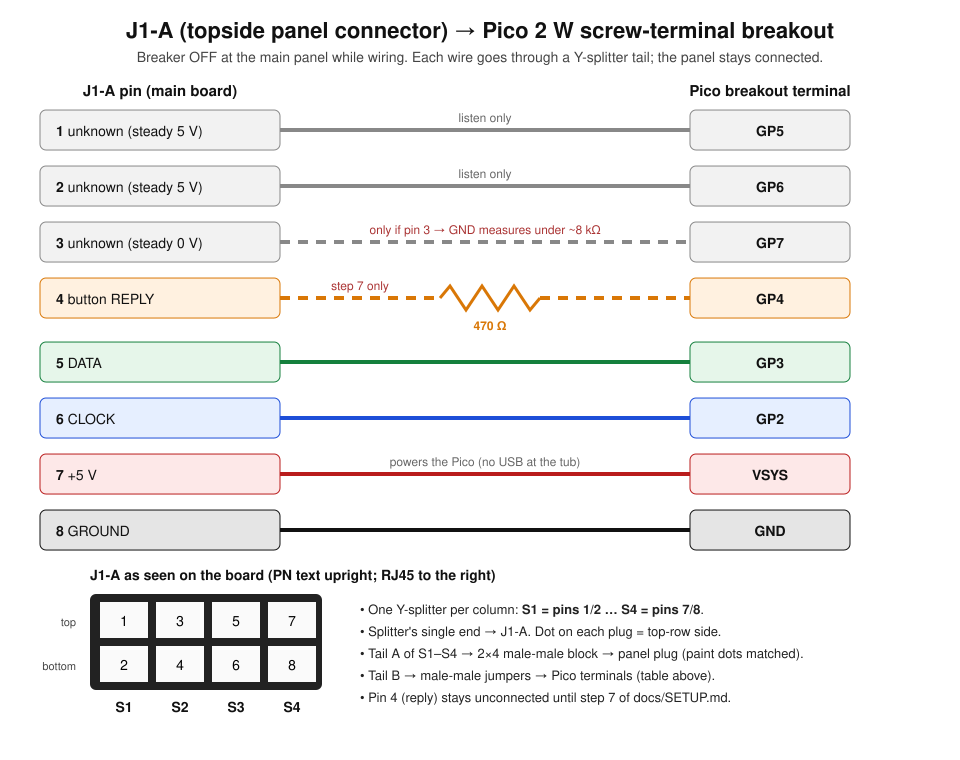
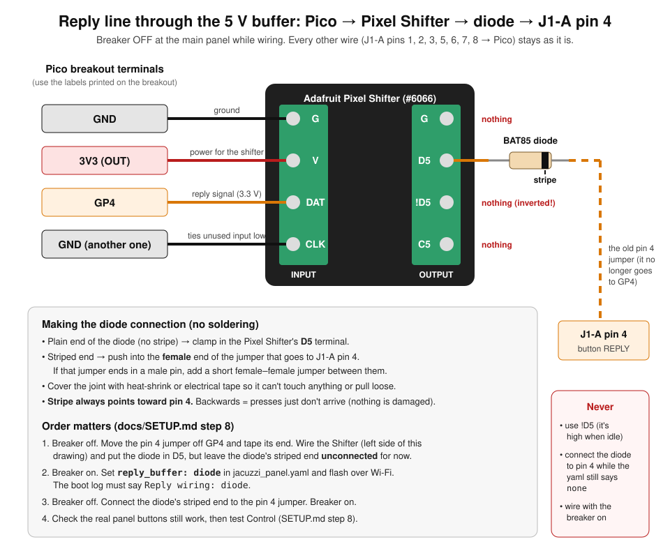

# Setup guide: Pico 2 W on the topside panel connector (J1-A)

Step-by-step instructions to build the tap, wire the Raspberry Pi Pico 2 W, flash it, add it
to Home Assistant and bring up button control safely. Written to be followed by someone at
the tub, with Claude Code helping (see [`CLAUDE.md`](../CLAUDE.md)).

> **Status (2026-10-27):** reading works on the tub (steps 1–6). Pressing buttons with the
> Pico's own 3.3 V output (step 7) was ignored by the board at every drive strength, so
> control goes through a small 5 V buffer board and a diode: **step 8**. Follow the order
> below. Each stage checks the previous one before anything is driven onto the bus.



---

## 0. Safety: read first

- The equipment bay holds **240 V** (relays, heater, pumps). **Switch the hot tub off at the
  main house panel** before opening it or touching anything inside. The spa's own GFCI
  disconnect isn't enough while you have the bay open.
- Only ever touch the low-voltage connector **J1-A** (and the RJ45 next to it). Don't reach
  past the board toward the relays or the big terminals.
- Signals on J1-A are 5 V. Nothing here needs mains wiring.
- **Never connect the Pico's USB cable while it is wired to the tub.** Flash it on the bench
  first; after that, updates and logs go over Wi-Fi.
- The Pico **only listens** until step 7. Even then, it only presses a button while the
  **Control Enabled** switch in Home Assistant is on (it is off after every reboot).

---

## 1. Parts

| Part | Qty | Example |
|---|---|---|
| Raspberry Pi Pico 2 W, **headers pre-soldered** | 1 | [Waveshare Pico 2 W pre-soldered](https://www.amazon.com/waveshare-Pre-Soldered-Raspberry-Microcontroller-Bluetooth/dp/B0DQ7NHGH8) |
| Screw-terminal breakout for Pico (must list Pico 2 support) | 1 | [Freenove Pico breakout](https://www.amazon.com/clp/B0BFB53Y2N) |
| 2-pin Y-splitter, **1 female → 2 female**, 2.54 mm (PC front-panel type) | 4 | [GELRHONR F→2F 10-pack](https://www.amazon.com/dp/B0DSZWFS1V) |
| 2.54 mm **double-row male header, equal-length pins on both sides** | 1 strip | [2×40 long-pin header](https://www.amazon.com/Break-away-Headers-2-54mm-Length-Centered/dp/B07842GC5F) |
| Male-to-male Dupont jumper wires | 8 | [ELEGOO jumper kit](https://www.amazon.com/Elegoo-EL-CP-004-Multicolored-Breadboard-arduino/dp/B01EV70C78) |
| 470 Ω resistor (1/4 W), *optional*. Without it, the firmware limits GP4 to 2 mA | 1 | any |
| Micro-USB data cable (for the first flash only) | 1 | any |
| **Step 8:** Adafruit Pixel Shifter (3.3 V → 5 V buffer, screw terminals) | 1 | [Adafruit #6066](https://www.adafruit.com/product/6066) (also on DigiKey) |
| **Step 8:** BAT85 Schottky diode (thin legs fit a Dupont socket) | 1 | [BAT85 100-pack](https://www.amazon.com/dp/B0CKSNPVH8) |
| **Step 8:** male-to-female (or female-female) Dupont jumper, heat-shrink or electrical tape | 1–2 | ELEGOO kit above has all three types |
| Multimeter (the FNIRSI 2C53T works) | 1 | |
| Fine marker / paint pen, masking tape, small zip ties | | |

Snap a **2×4 piece** off the male header strip (2 rows × 4 pins).

---

## 2. J1-A and the numbering we use

J1-A is the shrouded 2×4 pin header on the main board, just left of the RJ45 jack. The
panel cable plugs into it. With the board facing you and the `PN: 4PB00931D` text upright:

```
              board top edge
          ┌────┬────┬────┬────┐
  top row │ 1  │ 3  │ 5  │ 7  │
          ├────┼────┼────┼────┤      ← RJ45 jack is off to this side
  bot row │ 2  │ 4  │ 6  │ 8  │
          └────┴────┴────┴────┘
   column:  C1   C2   C3   C4
```

| J1-A pin | Signal | Goes to Pico |
|---|---|---|
| 1 | unknown (steady 5 V) | GP5 (listen only) |
| 2 | unknown (steady 5 V) | GP6 (listen only) |
| 3 | unknown (steady 0 V) | GP7 (listen only, **only if step 4 says OK**) |
| 4 | button reply | GP4 **through 470 Ω** (step 7 only) |
| 5 | data | GP3 |
| 6 | clock | GP2 |
| 7 | +5 V | VSYS (powers the Pico) |
| 8 | ground | GND |

Details: [j1a-pinout.md](j1a-pinout.md), [protocol.md](protocol.md).

---

## 3. Build and label the tap (at the table)

Each Y-splitter handles **one column** (two pins) of J1-A. Call them **S1–S4** for columns C1–C4.

1. **Label the splitters.** On each splitter put a tape flag: `S1` … `S4`. On each of its
   three plugs, make a **dot on the side that will face the top row** (pins 1/3/5/7). Do it
   the same way on all three plugs of a splitter, so "dot side = top row" is true at every end.
2. **Make the panel-side block.** Take the 2×4 male-male piece. Plug the **first tail** of
   S1, S2, S3, S4 onto one side of it, left to right, dots toward the same long edge (that
   edge = top row). Wrap with tape so they can't shift. Mark that edge "TOP".
3. **Second tails → jumpers.** Push a male-male jumper into each pin of each splitter's
   **second tail** (8 jumpers). Tag each jumper with its J1-A pin number (1–8) using the
   table above: S*n* dot side = pin 2*n*−1, other side = pin 2*n*.

---

## 4. Measure (breaker OFF at the main panel)

1. Open the bay. **Before unplugging anything, put a paint dot on the panel plug and a
   matching dot on the board next to J1-A pin 1** (top-left, column C1) so the plug can
   always go back the same way.
2. Unplug the panel plug from J1-A.
3. With the multimeter on **resistance (Ω)**, black lead on **pin 8**, measure on the
   **board's** pins and write the results in [j1a-pinout.md](j1a-pinout.md) (or tell Claude):

   | Measure | Result | Why |
   |---|---|---|
   | pin 4 → pin 8 (GND) | ____ Ω | reply line pull-down. Needed before control |
   | pin 4 → pin 7 (+5 V) | ____ Ω | |
   | pin 3 → pin 8 (GND) | ____ Ω | **under ~8 kΩ: OK to connect GP7. Otherwise leave pin 3 unconnected** |
   | pin 8 → board GND test point | ~0 Ω | confirms ground |

4. Plug the **panel plug back** directly (dot to dot) for now. Close the bay. The tub
   should work exactly as before.

---

## 5. Flash the Pico (on the bench, NOT connected to the tub)

1. **Install ESPHome** on the computer (Claude can do this):
   `python3 -m venv ~/esphome-venv && ~/esphome-venv/bin/pip install esphome`
2. **Secrets.** In the repo folder: `cp secrets.example.yaml secrets.yaml`, then fill in the
   Wi-Fi name and password for the house, and generate keys with
   `openssl rand -base64 32` for `api_encryption_key` and `panel_api_encryption_key`, plus any
   `ota_password` and `ap_password`. Keep this file private; it's ignored by git.
3. **Put the Pico in BOOTSEL mode:** hold the **BOOTSEL** button on the Pico, plug in the
   USB cable, then release. It appears as a USB drive (`RP2350`).
4. **Flash:** `~/esphome-venv/bin/esphome run jacuzzi_panel.yaml`
   (If that can't find the Pico, run `esphome compile jacuzzi_panel.yaml` and drag
   `.esphome/build/jacuzzi-panel/.pioenvs/jacuzzi-panel/firmware.uf2` onto the `RP2350` drive.)
5. **Check it joined Wi-Fi:** `~/esphome-venv/bin/esphome logs jacuzzi_panel.yaml`.
   At this point, with no tub, expect *"Panel Bus"* to be off. That's correct.
   Note the line `RP2350 chip revision field: N` (tells us whether erratum E9 applies).
6. Unplug USB. Put the Pico on the screw-terminal breakout.

---

## 6. Wire it up: listen only (breaker OFF at the main panel)

1. Breaker off. Unplug the panel plug from J1-A.
2. Push the **four single female ends** of S1–S4 onto J1-A: **S1 on column C1** (nearest the
   U5 chip) … **S4 on column C4** (nearest the RJ45), **dots toward the top row**.
3. Push the **panel plug onto the 2×4 block**, its paint dot at the C1/TOP corner. Tape and
   zip-tie so it can't pull off.
4. Connect jumpers to the breakout's screw terminals, using the **GPIO labels on the breakout**:

   | Jumper (J1-A pin) | Breakout terminal |
   |---|---|
   | 8 (ground) | **GND** |
   | 7 (+5 V) | **VSYS** |
   | 6 (clock) | **GP2** |
   | 5 (data) | **GP3** |
   | 1 | **GP5** |
   | 2 | **GP6** |
   | 3 | **GP7**: *only if pin 3 measured under ~8 kΩ*. Otherwise tape it off |
   | 4 (reply) | **leave unconnected for now**. Tape the end |

5. Double-check every jumper against the table. Make sure no bare metal touches anything.
6. Close the bay, **breaker on**. The panel display should come up normally.

**Check (with Claude, over Wi-Fi):** `esphome logs jacuzzi_panel.yaml`
- `Panel Bus` turns on; lines like `frame 1000…  heater=… jets1=… jets2=…` appear.
- `water NN` matches the number on the panel.
- Press **Jets 1** on the panel: `jets1=1` appears; press again → `0`. Same for Jets 2.
- Press **+** twice (the first press only shows the set point): about 5 s after the display
  goes back to the water temperature, `set point NN` is logged. Press **−** to put it back.
- In Home Assistant (**Settings → Devices & services**, add "Jacuzzi J355 Panel" with
  `panel_api_encryption_key`), the entities match what the panel shows.

If anything looks wrong, stop here. See *Troubleshooting*.

---

## 7. Connect the reply line and test control (breaker OFF to wire)

Only after step 6 works, and with the pin 4 measurements from step 4 recorded. In the
logs, the 30-second stats line `frames=…` must rise by **about 330 every 30 s**. If it rises
much more slowly, the bus isn't being read cleanly; fix that first.

1. Breaker off. Connect the **pin 4 jumper** to **GP4**:
   - **With a 470 Ω resistor** (preferred): clamp the resistor in the GP4 terminal and connect
     the jumper to its other leg, so the path is `J1-A pin 4 → jumper → 470 Ω → GP4`.
   - **Without a resistor:** jumper straight into GP4. `jacuzzi_panel.yaml` already sets
     `reply_drive_strength: 2mA`, which limits how hard the Pico can drive the line, so it
     can't push much current into the panel if they ever disagree.
   Breaker on.
2. In Home Assistant, turn on **Control Enabled**. (It refuses if the bus isn't being received.)
3. **First press: Temp Up, once.** The first + press only *shows* the set point, so this is
   harmless. Expect the panel display to switch to the set point for ~3 s, and the log to
   show `Pressing scan pos 4`.
   - **Display didn't react:** turn Control off. If you're wired without the resistor at
     `2mA`, try `reply_drive_strength: 4mA` (edit `jacuzzi_panel.yaml`, `esphome run` over
     Wi-Fi) and test again; `8mA` is the most to try **without** a resistor. If it still
     doesn't react, the tub's processor doesn't accept the Pico's 3.3 V: go to **step 8**.
4. **Jets 2 Button** → Jets 2 should start; press again → stop.
5. **Temp Up** twice, watch the set point go up by 1. **Temp Down** to put it back.
6. Turn **Control Enabled** off when you're done testing. It also goes off by itself
   after any reboot, or if the bus is lost for 2 s.

---

## 8. Control through the 5 V buffer (Pixel Shifter + diode)

Why: the board ignored the Pico's 3.3 V presses at 2, 4 and 8 mA (2026-10-27), with timing
that matches the real panel. The Adafruit Pixel Shifter turns GP4's 3.3 V into a 5 V signal.
Its output is always driven (low when idle), so it reaches pin 4 **through a diode**: high
passes, low is blocked, and pin 4 stays free for the real panel. `reply_buffer: diode` in
`jacuzzi_panel.yaml` tells the firmware to hold GP4 firmly low between presses.



Do it in this order. The diode only touches pin 4 once the firmware is in `diode` mode.

1. **Breaker off.** Take the pin 4 jumper off **GP4** and tape its end.
2. Wire the Pixel Shifter's **INPUT** block (labels on the board):

   | Pixel Shifter | Pico breakout terminal |
   |---|---|
   | **G** | **GND** |
   | **V** | **3V3 (OUT)** (the shifter makes its own 5 V) |
   | **DAT** | **GP4** |
   | **CLK** | another **GND** (unused input, tied low) |

3. Diode: clamp its **plain end** (no stripe) in the **OUTPUT D5** terminal. Leave the
   **striped end unconnected** for now. Leave **G, !D5, C5** on the OUTPUT side empty.
   **Never use !D5**: it's the inverted output, high when idle.
4. **Breaker on.** In `jacuzzi_panel.yaml`, set `reply_buffer: diode` (leave
   `reply_drive_strength` as is). Flash over Wi-Fi: `esphome run jacuzzi_panel.yaml`.
   **Check the boot log:** `Reply wiring: diode (GP4 -> 5 V buffer -> diode -> J1-A pin 4 …)`,
   the `PIO: capture …` line, and `frames` rising ~330 per 30 s.
5. **Breaker off.** Connect the diode's **striped end** to the pin 4 jumper: push the leg
   into a **female** Dupont end. If the pin 4 jumper's free end is male, swap it for a
   male-to-female jumper (male into the splitter tail, female onto the diode leg), or add a
   short female-female jumper. **Stripe toward pin 4.** Cover the joint with heat-shrink or
   tape. **Breaker on.**
6. **The real panel must still work:** press **+** twice on the panel by hand. The set point
   shows on the display, and about 5 s after it returns to water temperature the log shows
   `set point NN`. Put it back with **−**. If hand presses stop working, breaker off, unplug
   the diode from the pin 4 jumper, and report.
7. **Control test**, Control Enabled on, one step at a time with someone at the panel:
   **Temp Up** twice (the first press shows the set point, the second raises it by 1) →
   **Temp Down** to put it back → **Jets 2** on → **Jets 2** off → Control Enabled off.
   `drives` should rise by 3 per press.
   - **Presses logged but no reaction:** check the diode's direction (stripe toward pin 4)
     and the DAT/GP4 wire. Don't change anything else; report with the log.

To go back to the original wiring: breaker off, remove the Pixel Shifter and diode, set
`reply_buffer: none`, flash, then reconnect the pin 4 jumper to GP4 as in step 7.

---

## Troubleshooting

| Symptom | Likely cause / what to try |
|---|---|
| Panel display blank or odd after wiring | Breaker off. Check the panel plug is on the 2×4 block the right way round (dots at C1/TOP) and that S1–S4 are in the right columns. If in doubt, plug the panel straight back into J1-A. |
| `Panel Bus` off, no `frame` lines | Clock/data swapped (GP2 = pin 6, GP3 = pin 5), missing GND, or a splitter on the wrong column. |
| Frames appear but values are nonsense | A splitter is flipped (dot facing the wrong row) or columns are out of order. |
| Pico doesn't power up at the tub | VSYS jumper not on pin 7 (S4 dot side), or GND not on pin 8. |
| `set point` never appears | Normal until someone presses + or −; the set point is only sent while it's displayed. |
| Control won't turn on | Bus not received (fix that first); it's a safety interlock. |
| Press logged but display doesn't react | Direct wiring (step 7): this happened on 2026-10-27 at 2/4/8 mA; use the buffer, step 8. Buffer wiring (step 8): diode backwards (stripe must face pin 4), DAT not on GP4, or the shifter's V/G not connected. Don't add other "boost" circuits. |
| Real panel buttons stop working after step 8 | The yaml still says `reply_buffer: none` with the diode connected, or !D5 used instead of D5. Breaker off, unplug the diode from pin 4, check, report. |
| C-code error on the panel (e.g. C96) | Breaker off, unplug the Pico tap, plug the panel straight into J1-A, then power on. Report what was happening. |

## Undo everything

Breaker off → unplug the four splitters from J1-A → plug the panel plug straight back onto
J1-A (paint dot to paint dot) → breaker on. The tub is back to stock.

The read-only **RJ45 backup** (Waveshare, [`rj45/`](../rj45/README.md)) is separate and can stay
connected throughout.
